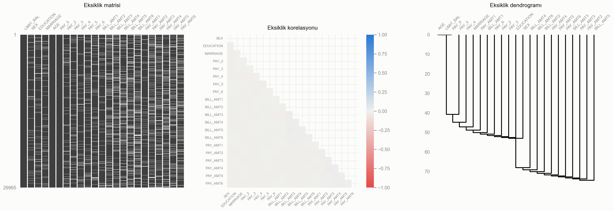
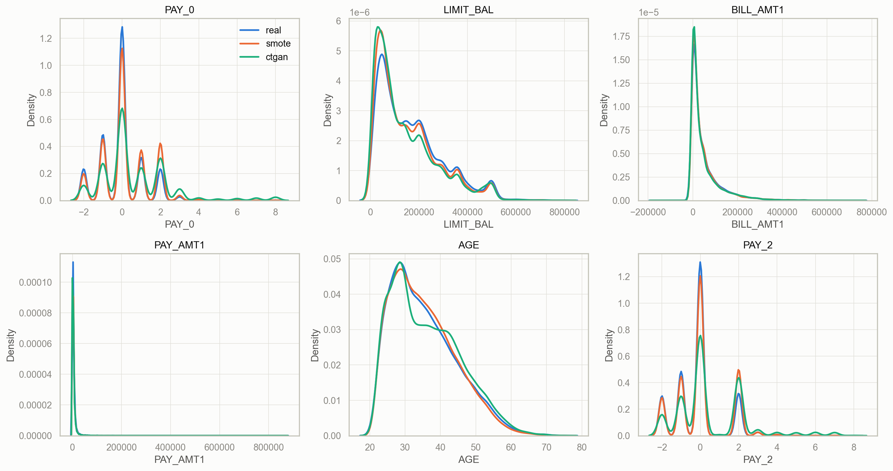
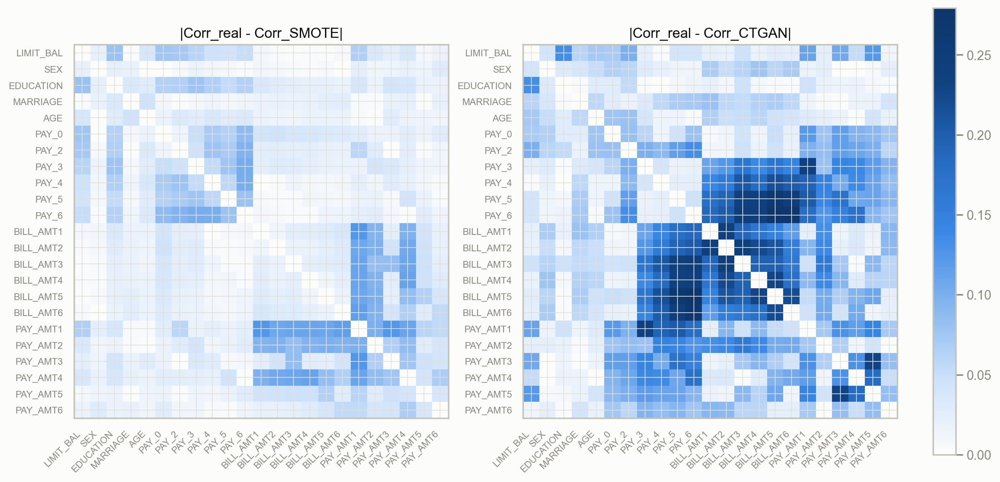
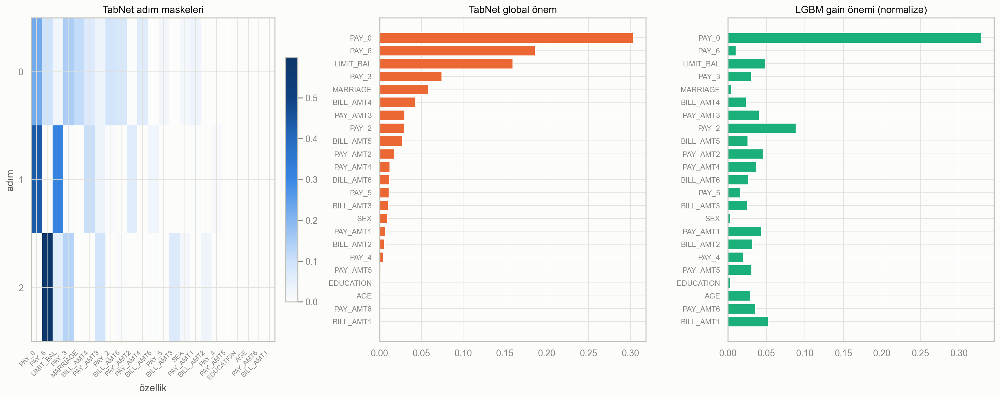
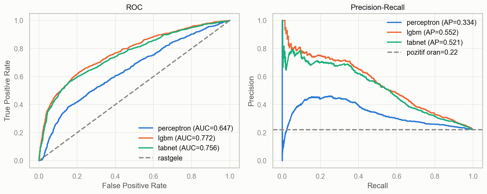
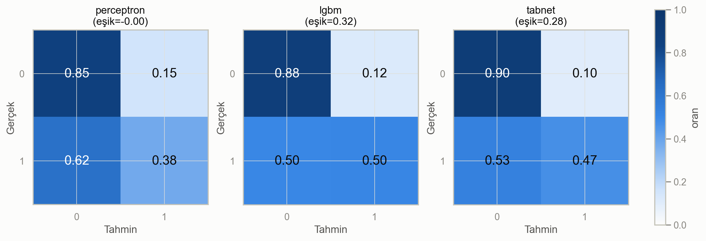

# Kredi Kartı Temerrüt Tahmini — Tabular Classification Projesi

Bu projede dengesiz bir tablo verisi üzerinde uçtan uca bir sınıflandırma hattı kuruyoruz. Hattın adımları:

1. Veri kalitesi kontrolü
2. Eksik veri doldurma (MVI)
3. İki yöntemle sentetik veri üretimi
4. Üç modelin karşılaştırılması: Perceptron, LightGBM + Optuna, TabNet

**Veri seti:** [Default of Credit Card Clients (UCI #350)](https://archive.ics.uci.edu/dataset/350)
**Ekip planı:** [`.claude/plans/ekip-is-paylasimi.plan.md`](.claude/plans/ekip-is-paylasimi.plan.md)

## Kısıtlar

Değerler `01_data_quality_mvi` notebook'unun çıktısından alındı (`reports/constraints.csv`).

| Kısıt | Gerekli | Bu proje |
|---|---|---|
| Satır | ≥ 20.000 | 29.965 (35 duplicate atıldıktan sonra) |
| Özellik | ≥ 20 | 23 |
| Kategorik oranı | ≥ %30 | %39,1 (9/23) |
| Eksik hücre | ≥ %5 | %7,96 (~%5 MCAR + ~%3 MAR, kontrollü ekleme) |
| Dengesizlik | ≥ 1:3 | 1:3,52 |

## Kurulum

Python 3.10 veya 3.11 gerekli.

```bash
python -m venv .venv
.venv\Scripts\activate            # macOS/Linux: source .venv/bin/activate
pip install torch --index-url https://download.pytorch.org/whl/cpu
pip install -r requirements.txt
pytest                            # ortak sözleşme testleri
```

Ham veri ilk çalıştırmada `ucimlrepo` ile indirilir ve `data/raw/` klasörüne kaydedilir. Bu klasör git'e eklenmez.

## Çalıştırma sırası

| Notebook | Sahibi | Ürettikleri |
|---|---|---|
| `00_smoke_test` | Ortak | Kurulum kontrolü |
| `01_data_quality_mvi` | Öğrenci 1 | `data/processed/clean_*.parquet`, `nan_mask.parquet`, Grafik 1 |
| `02_synthetic_data` | Öğrenci 1 | `train_smote`, `train_ctgan`, `synth_ctgan_full`, Grafik 2-3 |
| `03_perceptron_lgbm` | Öğrenci 2 | `models/preds/{perceptron,lgbm}.csv`, önem tablosu |
| `04_tabnet` | Öğrenci 3 | `models/preds/tabnet.csv`, maskeler |
| `05_evaluation_plots` | Öğrenci 3 | Grafik 4-6, final tablo |

## Ortak sözleşme

Herkes veriyi aynı yoldan yükler:

```python
from src.data import load_split, to_xy

train = load_split("train", variant="v0")   # Öğrenci 1'in dosyaları gelene kadar ham veri
X, y = to_xy(train)
```

`variant` parametresinin alabileceği değerler:

| Değer | Anlamı | Hangi split'lerde |
|---|---|---|
| `v0` | Ham veri, NaN yok | train, val, test |
| `clean` | Doldurulmuş ve temizlenmiş, ölçeklenmemiş | train, val, test |
| `smote` | Artırılmış veri | Sadece train |
| `ctgan` | Artırılmış veri | Sadece train |

- **Sabit bölme:** Bölme `data/splits.csv` dosyasında sabit. Oranlar 70/15/15, stratified, `SEED=42`. Bu dosya değiştirilmez.
- **Ön işleme:** `src.features.make_preprocessor(kind)` kullanılır, `kind` = `"linear"`, `"tree"` veya `"tabnet"`. Ön işleyici her zaman sadece train'e fit edilir.
- **Tahmin dosyaları:** `src.metrics.save_preds()` ile yazılır. Kolonlar: `row_id, y_true, y_score, y_pred, threshold`. Eşik val setinde `pick_threshold` ile seçilir.
- **Ortak kod:** `src/` altındaki ortak dosyalar yalnızca PR ile değişir.

## Final sonuçlar

Test setinde, val'de seçilen eşikle (`reports/final_metrics.csv`):

| Model | Macro-F1 | Weighted-F1 | ROC-AUC | PR-AUC | Accuracy* |
|---|---|---|---|---|---|
| **LightGBM** | **0,699** | 0,795 | **0,772** | **0,552** | 0,799 |
| TabNet | 0,696 | 0,797 | 0,756 | 0,521 | 0,804 |
| Perceptron | 0,617 | 0,740 | 0,647 | 0,334 | 0,745 |

\*Accuracy sadece bilgi amaçlı; ana metrikler Macro-F1 ve PR-AUC (dengesiz veri).

LightGBM ve TabNet'in Macro-F1'i birbirine çok yakın (fark ≈0,002), ama eşikten bağımsız metriklerde (ROC-AUC ≈0,772 vs ≈0,756, özellikle PR-AUC ≈0,552 vs ≈0,521) LightGBM tutarlı şekilde önde. İki model de en önemli özellik olarak `PAY_0`'ı (son ödeme durumu) buluyor, ama geri kalan sıralama çok farklı (Grafik 4; Spearman sıra korelasyonu ≈0,10). Perceptron, doğrusal karar sınırı nedeniyle üç metrikte de belirgin şekilde geride.

**MVI karşılaştırması** (`reports/mvi_comparison.csv`): MICE (BayesianRidge) en düşük NRMSE'yi (0,446) veriyor. Model faydası açısından (val Macro-F1) yöntemler pratikte aynı: baseline'ı (median/mode, 0,7053) yalnızca KNN (k=5) geçiyor, o da +0,002 (0,7073). MICE baseline'la aynı (0,7058), KNN (k=10) altında (0,7041). Öğrenci 1, üç ölçütün sıra ortalamasına göre KNN (k=5)'i seçti.

**Sentetik veri fidelity** (`reports/fidelity_summary.csv`): SMOTE-NC, CTGAN'a göre gerçek dağılıma çok daha sadık kalıyor (ortalama |ΔCorr| 0,034 vs 0,064-0,082); CTGAN yeni örnek çeşitliliği sunuyor ama korelasyon yapısını daha fazla bozuyor.

## Grafikler

| Grafik 1 — Eksiklik | Grafik 2 — Gerçek/SMOTE/CTGAN |
|---|---|
|  |  |

| Grafik 3 — Korelasyon farkı | Grafik 4 — Önem/maskeler |
|---|---|
|  |  |

| Grafik 5 — ROC/PR | Grafik 6 — Confusion matrix |
|---|---|
|  |  |

## Kim ne yaptı

| Kişi | Rol | Katkı |
|---|---|---|
| Öğrenci 1 | Veri kalitesi & sentetik veri | Veri kalitesi analizi, %8 eksik veri ekleme (MCAR+MAR), 3 MVI yöntemi karşılaştırması, encoding/ölçekleme, SMOTE-NC + CTGAN, fidelity/TSTR-TRTR ölçümleri, Grafik 1-3 (ilk sürüm) |
| Öğrenci 2 | Klasik & ağaç tabanlı modeller | Dummy baseline, Perceptron (parametre taraması + öğrenme eğrisi), LightGBM + Optuna (5-fold CV, PR-AUC), eğitim seti karşılaştırması (clean/SMOTE/CTGAN), final tahminler + importance |
| Öğrenci 3 | TabNet & karşılaştırmalı analiz | TabNet kurulumu, grid tuning, eğitim eğrileri, final model + maskeler, `src/plots.py` grafik altyapısı, Grafik 1-6'nın final hali, final metrik tablosu, PEP-8 taraması |

Ayrıntılı iş bölümü ve zaman çizelgesi için: [`.claude/plans/ekip-is-paylasimi.plan.md`](.claude/plans/ekip-is-paylasimi.plan.md)
