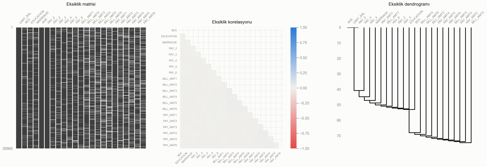
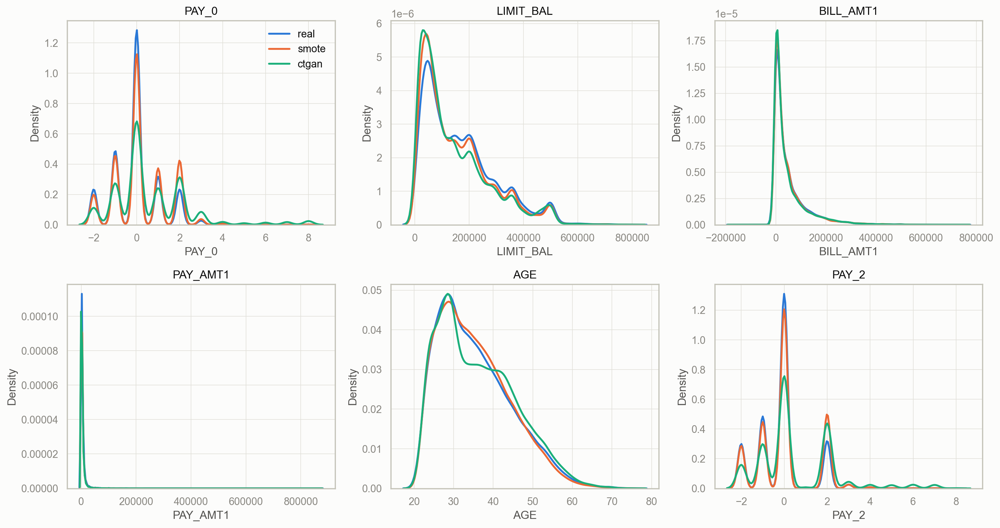
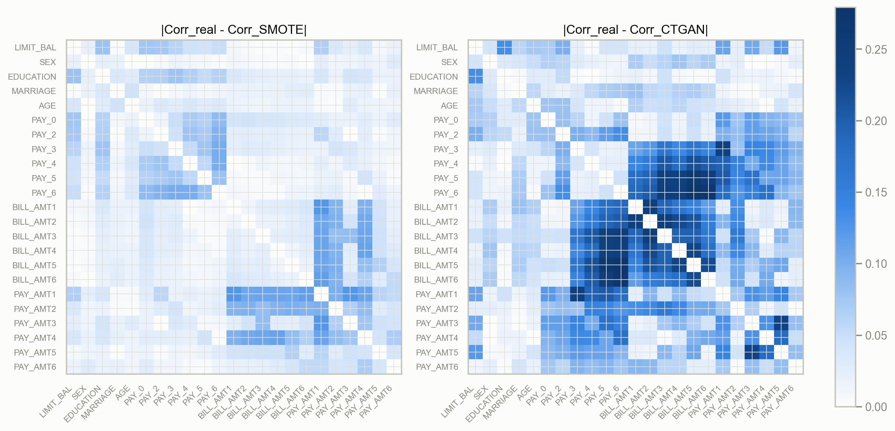
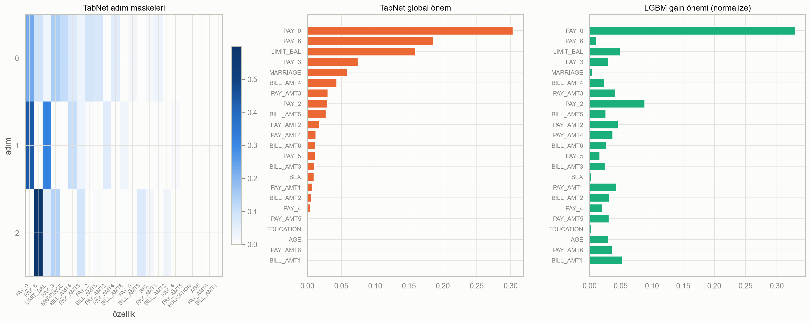
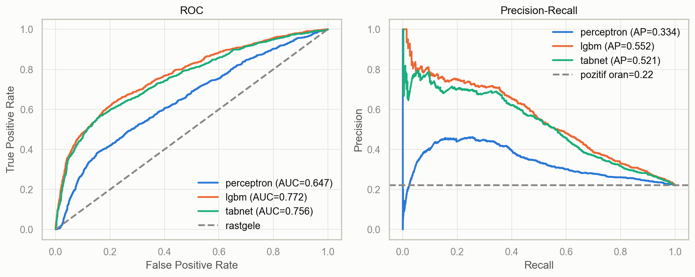
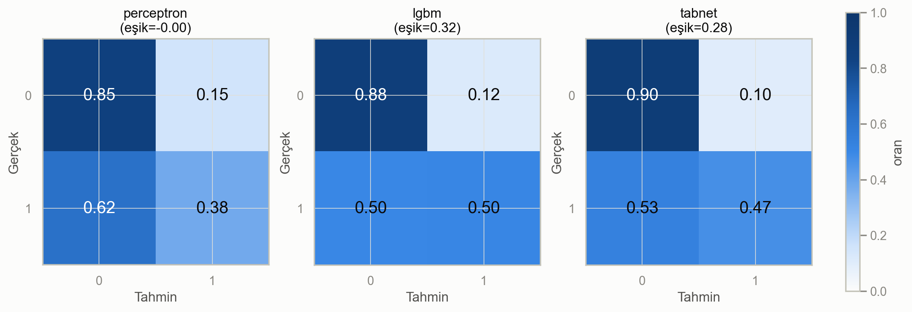
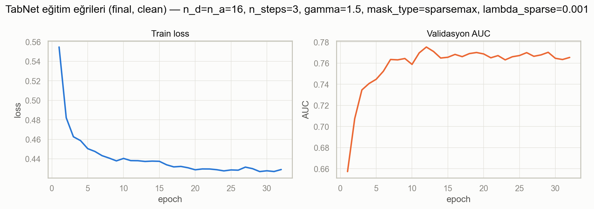
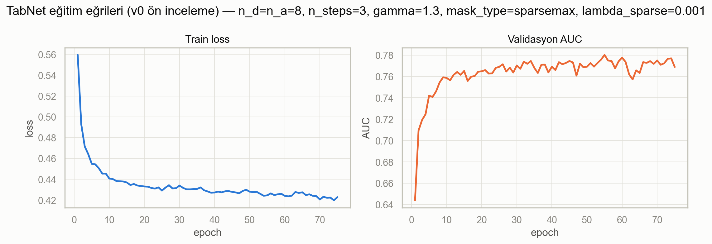

# Grafiklerin açıklaması

Bu dosya projedeki 8 grafiği tek tek anlatır: ne gösterdiğini, nasıl okunacağını ve ne çıktığını.
Grafik 1-3 ve 4-6 ödevin istediği 6 zorunlu grafiktir; 7 ve 8 TabNet'in eğitim eğrileridir.

Grafikleri üreten kod: `notebooks/05_evaluation_plots.ipynb` (Grafik 1-6) ve
`notebooks/04_tabnet.ipynb` (eğitim eğrileri). Çizim fonksiyonları `src/plots.py` içinde.

Kısa sözlük:

| Terim | Anlamı |
|---|---|
| Temerrüt (`default`) | Müşteri gelecek ay kart borcunu ödemedi. 1 = ödemedi, 0 = ödedi. |
| Azınlık sınıfı | Ödemeyen müşteriler. Verinin yaklaşık %22'si. |
| Sentetik veri | Gerçek veriye benzetilerek üretilmiş sahte satırlar (SMOTE-NC ve CTGAN ile). |
| Val / test | Model seçimi için ayrılan deneme seti / sonuçların ölçüldüğü, modelin hiç görmediği final seti. |

---

## Grafik 1 — Eksik veri nerede?

**Ne gösteriyor:** Veride başta hiç eksik hücre yoktu. Ödev en az %5 eksik istediği için
Öğrenci 1 bilerek %7,96 oranında hücre sildi. Bu grafik silinen hücrelerin nerede olduğunu gösterir.

**Nasıl okunur:**
- **Sol (eksiklik matrisi):** Her sütun bir özellik, her satır bir müşteri. Koyu renk dolu hücre,
  beyaz çizgi eksik hücre.
- **Orta (eksiklik korelasyonu):** İki sütunun aynı satırda birlikte boş olma eğilimi.
  Gri = ilişki yok, mavi = birlikte boşalıyor, kırmızı = biri boşken öteki dolu.
- **Sağ (dendrogram):** Eksiklik desenleri benzeyen sütunları aynı dalda birleştirir.

**Ne çıktı:**
- `LIMIT_BAL`, `AGE` ve `PAY_0` sütunları tamamen dolu. Bunlara bilerek dokunulmadı, çünkü MAR
  mekanizması bu sütunlara bakarak eksiklik üretiyor (yaşlıda fatura, düşük limitte ödeme bilgisi
  daha sık kayboluyor).
- Korelasyon paneli neredeyse tamamen gri: bir sütunun boş olması başka bir sütunun boş
  olacağını söylemiyor.

---

## Grafik 2 — Sentetik veri gerçeğe benziyor mu?

**Ne gösteriyor:** En önemli 6 özellikte üç dağılımın karşılaştırması. Sadece **azınlık sınıfı**
(ödemeyen müşteriler) kullanıldı, çünkü sentetik satırlar yalnızca bu sınıf için üretildi.

- Mavi: gerçek azınlık satırları (4.641 satır)
- Turuncu: SMOTE-NC'nin ürettiği satırlar (11.693 satır)
- Yeşil: CTGAN'ın ürettiği satırlar (11.693 satır)

**Nasıl okunur:** Çizgiler ne kadar üst üste biniyorsa, sentetik veri gerçeğe o kadar benziyor.

**Ne çıktı:**
- SMOTE (turuncu) gerçeğe (mavi) çok yakın. SMOTE iki benzer gerçek müşterinin arasına yeni
  müşteri koyduğu için gerçek dağılımın dışına pek çıkmıyor.
- CTGAN (yeşil) bazı yerlerde sapıyor. `PAY_0` ve `PAY_2`'de 4-8 arası gecikme kodlarını
  gerçekte olduğundan çok daha sık üretiyor. `AGE`'de 35 yaş civarında gerçekte olmayan bir çukur var.

> **Düzeltilen hata:** İlk sürümde `train_smote` ve `train_ctgan` dosyalarının tamamı
> "sentetik" diye çizilmişti. Bu dosyalar gerçek satırları da içerdiği için fark olduğundan küçük
> görünüyordu. Şimdi sadece `is_synthetic == True` olan satırlar kullanılıyor.

---

## Grafik 3 — Sütunlar arası ilişki bozuldu mu?

**Ne gösteriyor:** Gerçek verideki sütun ilişkileri (korelasyon) ile sentetik verideki
ilişkiler arasındaki fark: `|Corr_gerçek − Corr_sentetik|`. Yine sadece azınlık sınıfı.

**Nasıl okunur:** Her kare iki sütunun ilişkisi. Beyaz = ilişki aynen korunmuş,
koyu mavi = ilişki bozulmuş. İki panel aynı renk ölçeğini kullanır, doğrudan karşılaştırılabilir.

**Ne çıktı:**

| Yöntem | Ortalama fark | Yorum |
|---|---|---|
| SMOTE-NC | 0,034 | Neredeyse tamamen açık renk, ilişkiler korunuyor |
| CTGAN | 0,082 | `PAY_3`–`PAY_6` ile `BILL_AMT` bölgesi koyu, ilişki bozuluyor |

Bu sayılar Öğrenci 1'in `reports/fidelity_summary.csv` dosyasıyla birebir aynı.

**Sonuç:** SMOTE gerçeğe daha sadık ama yeni bilgi üretmiyor. CTGAN yeni örnekler üretiyor ama
sütunlar arası ilişkiyi bozuyor.

---

## Grafik 4 — Model hangi özelliklere bakıyor?

**Ne gösteriyor:** İki modelin karar verirken hangi özelliği ne kadar kullandığı.
Özellik sırası üç panelde de aynı (TabNet önemine göre sıralı).

**Nasıl okunur:**
- **Sol (TabNet adım maskeleri):** TabNet kararını 3 adımda verir. Her satır bir adım, koyu
  renk o adımda en çok bakılan özellik.
- **Orta (TabNet global önem):** Tüm adımların toplamında her özelliğin payı.
- **Sağ (LightGBM gain önemi):** LightGBM'de her özelliğin modele kattığı kazanç, toplamı 1.

**Ne çıktı:**
- İki model de **`PAY_0`**'ı en önemli özellik buluyor (TabNet ≈%30, LightGBM ≈%33).
  `PAY_0` müşterinin son ayki ödeme durumu: zamanında mı ödedi, kaç ay gecikti.
- Uyum sadece birinci sırada. Geri kalan sıralama çok farklı (Spearman sıra korelasyonu ≈0,10):
  TabNet'in 2. özelliği `PAY_6`, LightGBM'de 20. sırada; LightGBM'in 2. özelliği `PAY_2` ise
  TabNet'te 8. sırada.
- TabNet'in maskeleri seyrek: her adımda birkaç özelliğe odaklanıp gerisini neredeyse yok sayıyor
  (`sparsemax` ayarının etkisi).

---

## Grafik 5 — ROC ve Precision-Recall eğrileri

**Ne gösteriyor:** Üç modelin test setindeki ayırt etme gücü. Bu eğriler eşikten bağımsızdır:
modelin "ödemez" kararını nereden kestiğine değil, müşterileri riske göre ne kadar iyi sıraladığına bakar.

**Nasıl okunur:**
- **Sol (ROC):** Eğri sol üst köşeye ne kadar yakınsa o kadar iyi. Kesikli köşegen rastgele
  tahmin (AUC = 0,5).
- **Sağ (Precision-Recall):** Model "ödemez" dediğinde ne kadar haklı (precision), gerçek
  ödemeyenlerin ne kadarını yakalıyor (recall). Kesikli yatay çizgi = ödemeyen oranı (0,22),
  rastgele tahminin alacağı skor.

**Ne çıktı:**

| Model | ROC-AUC | PR-AUC (AP) |
|---|---|---|
| LightGBM | **0,772** | **0,552** |
| TabNet | 0,756 | 0,521 |
| Perceptron | 0,647 | 0,334 |

LightGBM ve TabNet eğrileri birbirine yakın, LightGBM her iki metrikte biraz önde.
Perceptron belirgin şekilde geride ama yine de rastgeleden iyi.

---

## Grafik 6 — Karışıklık matrisi (confusion matrix)

**Ne gösteriyor:** Her modelin test setinde doğru ve yanlış tahminleri. Değerler satır bazında
normalize edildi, yani her satır toplamı 1. Başlıktaki eşik, validasyon setinde Macro-F1'i
en yükseğe çıkaran karar eşiğidir.

**Nasıl okunur:**

|  | Tahmin: öder (0) | Tahmin: ödemez (1) |
|---|---|---|
| **Gerçek: öder (0)** | Doğru | Yanlış alarm |
| **Gerçek: ödemez (1)** | Kaçırılan borçlu | Yakalanan borçlu |

**Ne çıktı:**

| Model | Eşik | Ödeyeni doğru bilme | Ödemeyeni yakalama |
|---|---|---|---|
| LightGBM | 0,32 | %88 | **%50** |
| TabNet | 0,28 | **%90** | %47 |
| Perceptron | ≈0 | %85 | %38 |

- Eşikler 0,5 değil 0,28-0,32. Ödemeyen müşteri az olduğu için eşik düşürülerek daha çok
  borçlu yakalanıyor.
- TabNet ödeyenleri biraz daha iyi tanıyor, LightGBM ödemeyenleri biraz daha iyi yakalıyor.
- En iyi model bile ödemeyenlerin yaklaşık yarısını kaçırıyor. 23 özellikteki bilgi bundan
  fazlasına yetmiyor.

---

## Grafik 7 — Final TabNet eğitim eğrisi

**Ne gösteriyor:** Final TabNet modelinin (clean veri, `n_d=n_a=16, n_steps=3, gamma=1.5`)
eğitim boyunca nasıl öğrendiği.

**Nasıl okunur:**
- **Sol (train loss):** Eğitim hatası. Düşüyorsa model öğreniyor.
- **Sağ (validasyon AUC):** Modelin görmediği validasyon setindeki başarısı.

**Ne çıktı:**
- Hata ilk 5 epoch'ta hızla düşüyor, sonra yavaşlıyor. Model düzgün öğreniyor.
- Validasyon AUC'si 12. epoch civarında zirve yapıyor (≈0,775), sonra yatay gidiyor.
- 20 epoch boyunca iyileşme olmayınca erken durdurma devreye girdi ve eğitim 32. epoch'ta
  kesildi. Model en iyi (12. epoch) ağırlıklarına geri döndü.

> **Düzeltilen hata:** Erken durdurma başta yanlışlıkla AUC yerine logloss'a bakıyordu.
> `pytorch-tabnet` listedeki son metriği izlediği için sıra `["logloss", "auc"]` yapıldı.

---

## Grafik 8 — v0 ön inceleme eğrisi

**Ne gösteriyor:** Hafta 1'de, Öğrenci 1'in temiz verisi gelmeden önce ham (`v0`) veriyle eğitilen
modelin eğrisi (`n_d=n_a=8, n_steps=3, gamma=1.3`). **Final model değildir**, sadece karşılaştırma
için tutuldu.

**Ne çıktı:** Bu model daha uzun eğitildi (75 epoch) ve benzer bir AUC seviyesine (≈0,78) ulaştı.
Temiz veriye geçince en iyi ayar değişti (`n_d=8` yerine `n_d=16`), çünkü hiperparametre
sıralaması verinin kendisine bağlı.
